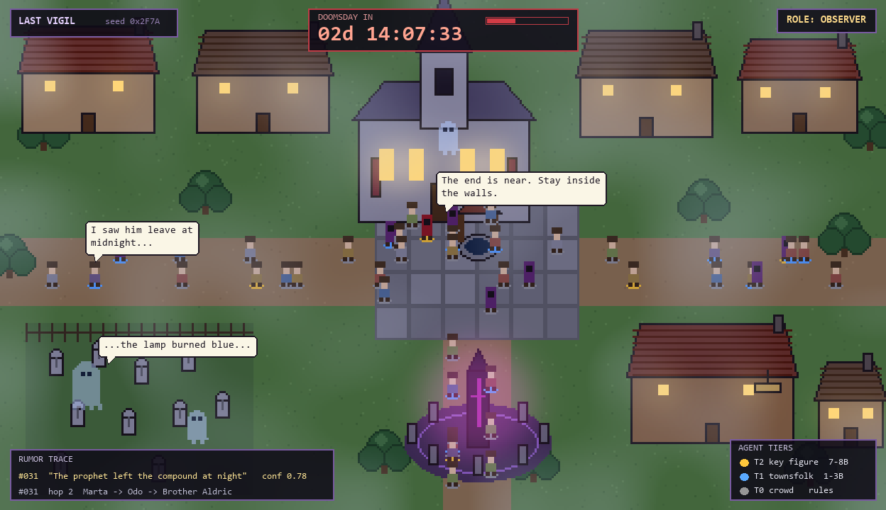
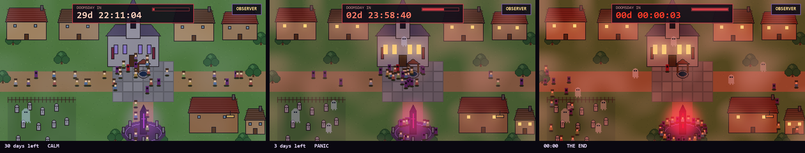
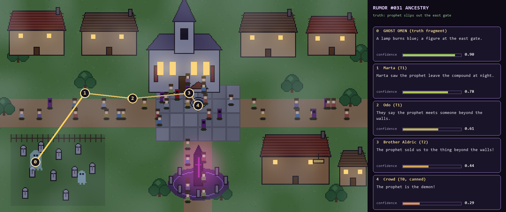
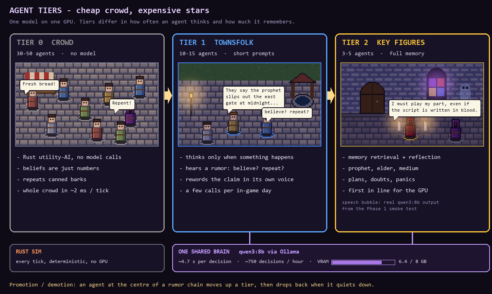
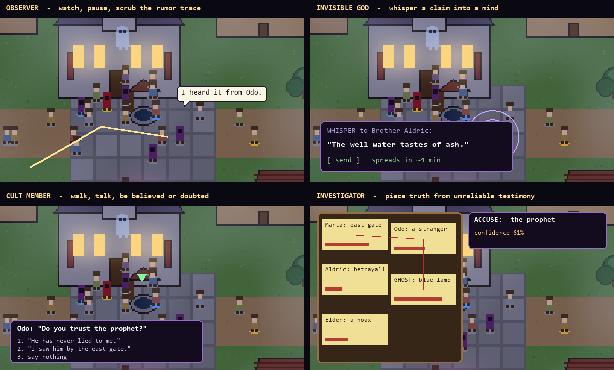
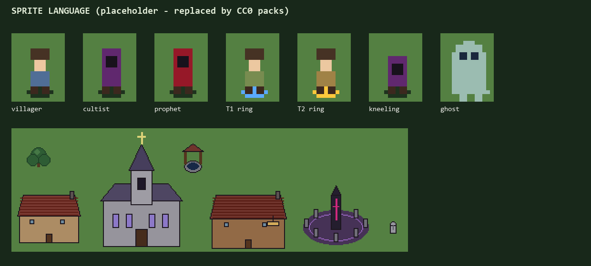
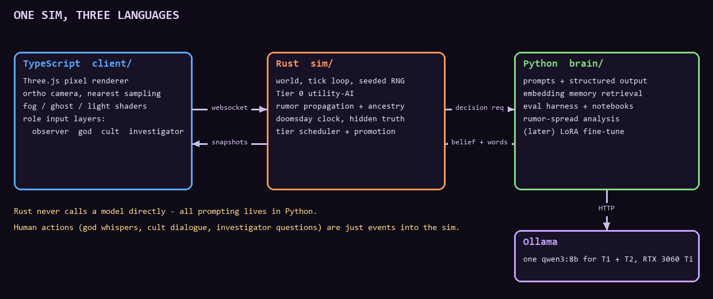

# Last Vigil

**A haunted medieval town. A doomsday cult. A countdown only some of them believe.**
Fifty-plus agents, running on local models on one GPU, spread rumors, panic, and pray as the last days tick away. You get to watch, whisper, infiltrate, or investigate.



> **Status: planning.** Every image in this README is a **concept render** generated by [`tools/render_concept.py`](tools/render_concept.py) (Pillow, no external assets). They show the intended look and UI, not screenshots of a running game. See [`PRD.md`](PRD.md) for the build plan.

## The idea

Each run generates a **hidden truth**: the prophet is a fraud, someone is hoarding grain, the date was a miscalculation, or the doom is real. The agents never see it. They only know what they've seen or been told, and a few ghosts hold true fragments they can only share through omens and dreams.

A **doomsday countdown** is visible to everyone in town. Agents know that at zero, they may die. What they do about that is the point of the simulation.

## Watch the town fall apart

Same town, same seed, three moments. Calm with 30 days left, panic at 3 days, and the final seconds. Lighting, fog, ghost count, and crowd behavior all follow the clock.



## Short runs, long runs, and replays

You choose a run's length before it starts: **Quick** (~10–15 min) for showing it off, **Standard** (~30–45 min) for watching a full arc, or **Long** (hours) for gathering data. Every model decision is written to a replay log, so any run, including a strange one, can be played back exactly with no GPU needed.

## Rumors you can trace

A rumor is a structured claim (subject, claim, source, confidence, hop count) that the Rust sim tracks exactly. At each hop a language model rewrites the wording, so the *ancestry* stays queryable while the *text* drifts like a game of telephone. A ghost's true omen can end up as "the prophet is the demon!" five hops later.



## Cheap crowd, expensive stars

You can't run 50 agents on an 8 GB GPU if every one of them calls a model. So agents are tiered, and the tiers can change mid-run: an agent at the center of a rumor chain gets promoted to a smarter brain, then demoted when things quiet down.



## Pick how you play

All four roles run on the same simulation. They differ only in what input you have.



## The look

Top-down pixel art rendered in Three.js with an orthographic camera and nearest-neighbor sampling, so it reads like a classic 2D game while still allowing shaders for fog, ghost translucency, and glow. The placeholder sprites below will be swapped for CC0 tilesets.



## One sim, three languages

Each language does what it's best at.



| Folder | Language | Job |
|---|---|---|
| `sim/` | Rust | World, tick loop, rumor propagation, doomsday clock, tier scheduling |
| `brain/` | Python | Prompting, structured output, memory retrieval, LoRA fine-tuning, evals |
| `client/` | TypeScript | Three.js renderer, UI, role input layers |

Models run locally through Ollama on an RTX 3060 Ti (8 GB). The smoke test (`python brain/agent_smoke_test.py`) found that a 3B and an 8B model can't stay loaded side by side, so every thinking tier shares one `qwen3:8b`. Tiers differ in how often they think, how much they remember, and whether they reflect. Measured speed: about 4.7 s per decision, 60 tok/s, entirely on the GPU.

## Build order

1. Toolchain and skeleton
2. Headless sim core (Tier 0 crowd)
3. Rumor engine
4. Brain service and Tier 1/2 agents
5. Three.js world (observer mode)
6. Ghosts and the haunted layer
7. God role
8. Tier promotion/demotion
9. Cult member role
10. Investigator role and endings
11. *(stretch)* In-character LoRA fine-tune trained on replay logs

Details, completion criteria, and risks are in [`PRD.md`](PRD.md). Project vocabulary (claim, hop, tier, omen...) is defined in [`GLOSSARY.md`](GLOSSARY.md), and the reasoning behind decisions that are hard to reverse is in [`docs/adr/`](docs/adr/).

## Working on this with Claude Code

The repo enables the [Matt Pocock skills](https://github.com/mattpocock/skills) plugin in `.claude/settings.json`. When you open the repo, Claude Code prompts you to install it. `/teach`, `/tdd`, `/diagnosing-bugs`, and `/domain-modeling` are the most useful ones here.

## Regenerating the concept art

```
pip install pillow
python tools/render_concept.py
```

Images are written to `docs/img/`. Once the real client exists, these will be replaced with actual screenshots.
