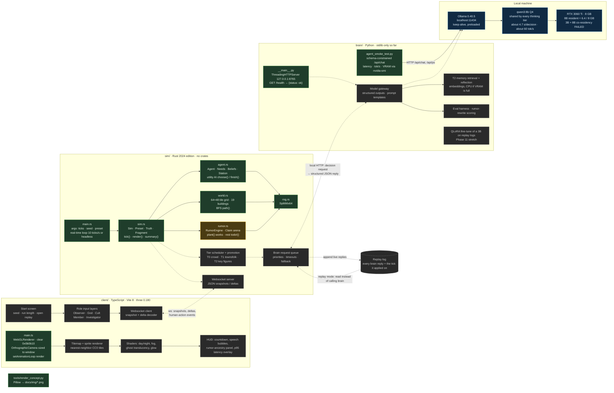
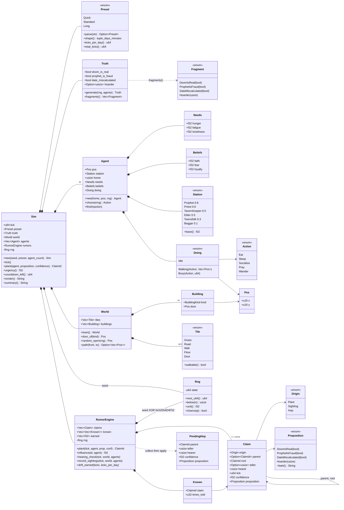
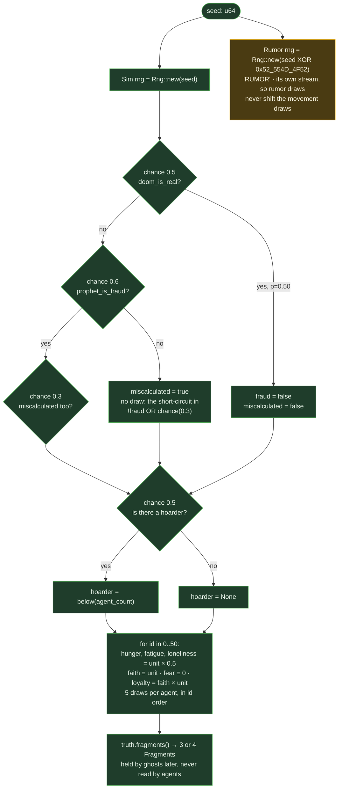
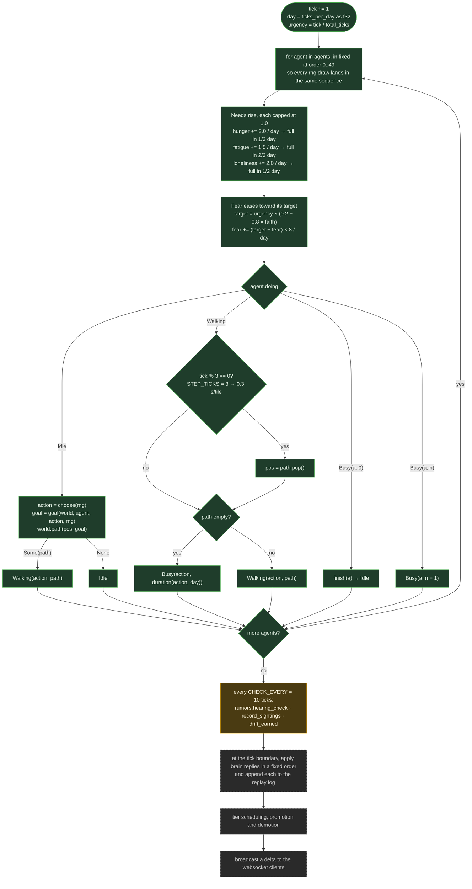
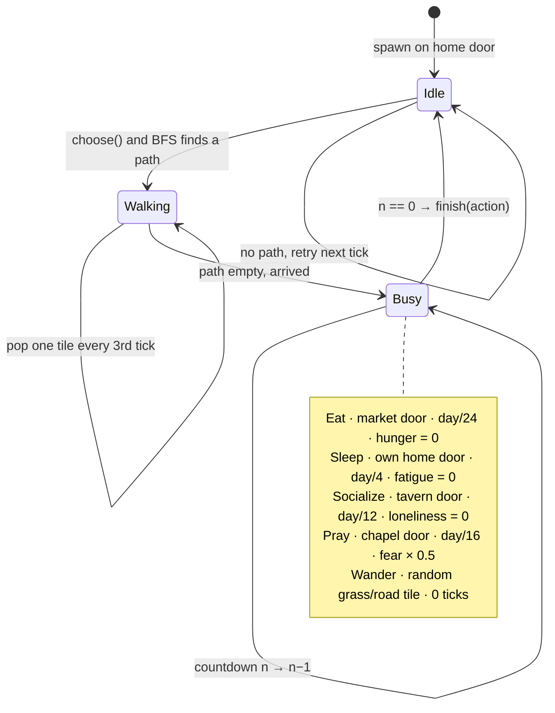
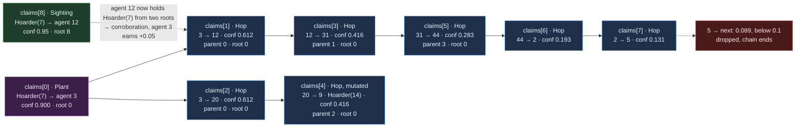
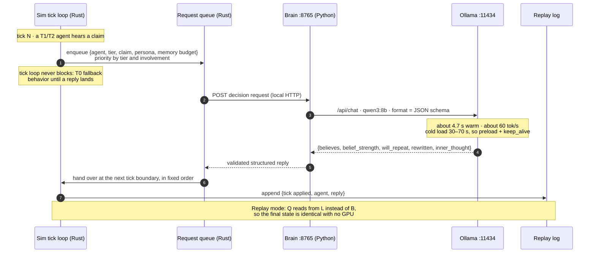

# Last Vigil

**A haunted medieval town. A doomsday cult. A countdown only some of them believe.**
Fifty-plus agents, running on local models on one GPU, spread rumors, panic, and pray as the last days tick away. You get to watch, whisper, infiltrate, or investigate.


> **Status: planning.** Every image in this README is a **concept render** generated by [`tools/render_concept.py`](tools/render_concept.py) (Pillow, no external assets). They show the intended look and UI, not screenshots of a running game. See [`PRD.md`](PRD.md) for the build plan.

## The idea

Each run generates a **hidden truth**: the prophet is a fraud, someone is hoarding grain, the date was a miscalculation, or the doom is real. The agents never see it. They only know what they've seen or been told, and a few ghosts hold true fragments they can only share through omens and dreams.

A **doomsday countdown** is visible to everyone in town. Agents know that at zero, they may die. What they do about that is the point of the simulation.

## Watch the town fall apart

Same town, same seed, three moments. Calm with 30 days left, panic at 3 days, and the final seconds. Lighting, fog, ghost count, and crowd behavior all follow the clock.


## Short runs, long runs, and replays

You choose a run's length before it starts: **Quick** (~10–15 min) for showing it off, **Standard** (~30–45 min) for watching a full arc, or **Long** (hours) for gathering data. Every model decision is written to a replay log, so any run, including a strange one, can be played back exactly with no GPU needed.

## Rumors you can trace

A rumor is a structured claim (subject, claim, source, confidence, hop count) that the Rust sim tracks exactly. At each hop a language model rewrites the wording, so the *ancestry* stays queryable while the *text* drifts like a game of telephone. A ghost's true omen can end up as "the prophet is the demon!" five hops later.


## Cheap crowd, expensive stars

You can't run 50 agents on an 8 GB GPU if every one of them calls a model. So agents are tiered, and the tiers can change mid-run: an agent at the center of a rumor chain gets promoted to a smarter brain, then demoted when things quiet down.


## Pick how you play

All four roles run on the same simulation. They differ only in what input you have.


## The look

Top-down pixel art rendered in Three.js with an orthographic camera and nearest-neighbor sampling, so it reads like a classic 2D game while still allowing shaders for fog, ghost translucency, and glow. The placeholder sprites below will be swapped for CC0 tilesets.


## One sim, three languages

Each language does what it's best at.


| Folder | Language | Job |
|---|---|---|
| `sim/` | Rust | World, tick loop, rumor propagation, doomsday clock, tier scheduling |
| `brain/` | Python | Prompting, structured output, memory retrieval, LoRA fine-tuning, evals |
| `client/` | TypeScript | Three.js renderer, UI, role input layers |

Models run locally through Ollama on an RTX 3060 Ti (8 GB). The smoke test (`python brain/agent_smoke_test.py`) found that a 3B and an 8B model can't stay loaded side by side, so every thinking tier shares one `qwen3:8b`. Tiers differ in how often they think, how much they remember, and whether they reflect. Measured speed: about 4.7 s per decision, 60 tok/s, entirely on the GPU.

## Schematics

These drawings are taken from the code as it is now (`sim/src/*.rs`, `brain/`, `client/src/main.ts`) and from the settled designs (`docs/rumor-engine.md`, ADRs 0001–0004, `PRD.md`). Each one marks what is **built**, what is **stubbed** (types and signatures exist, but the body is `todo!()`), and what is **planned** (not in the code yet). Every number shown is the actual constant in the code or the starting value in the design doc.

Legend for the flowcharts: green = built and running, amber = stubbed in code, grey dashed = planned only.

### 1. System schematic: processes, ports, and wires



Rust never calls a model (ADR 0001). All prompting stays in Python, so the sim can run with the brain stubbed or replaced, and a replay needs no GPU.

### 2. Sim crate: module wiring and data model



Every collection is a `Vec` indexed by id, never a `HashMap`, because `format!("{sim:?}")` is the determinism fingerprint (ADR 0003). An agent's id is its index in `Sim::agents`, and a claim's id is its index in `RumorEngine::claims`.

### 3. The town, tile by tile

This is the exact output of `World::town()` (`cargo run --release -- 0 42 quick`, agent letters removed). The grid is 64 × 48 tiles. The roads cross at (32, 24).

```
         x=0         10        20        30        40        50        60  63
           |         |         |         |  ROAD_X=32        |         |   |
  y= 0     ................................=...............................
           ................................=...............................
           ................................=...............................
           ................................=...............................
  y= 4     ............................#########...........................   ← CHAPEL (28,4) 9×7
           ............................#       #...........................     the chapel sits on the
           ............................#       #...........................     N road; the road north
           ............................#       #...........................     of it is a dead end
           ............................#       #...........................
           ............................#       #...........................
  y=10     ............................####+####...........................   ← chapel door (32,10)
           ................................=...............................
           ................................=...............................
           ................................=...............................
           ................................=...............................
           ................................=...............................
           ................................=...............................
           ................................=...............................
  y=18     ..#####.#####.#####.#####.......=.....#####.#####.#####.#####...   ← north homes, 5×4
           ..#   #.#   #.#   #.#   #.......=.....#   #.#   #.#   #.#   #...
           ..#   #.#   #.#   #.#   #.......=.....#   #.#   #.#   #.#   #...
  y=21     ..##+##.##+##.##+##.##+##.......=.....##+##.##+##.##+##.##+##...   ← doors face south
           ................................=...............................
           ................................=...............................
  y=24     ================================================================   ← ROAD_Y=24
           ................................=...............................
  y=26     ....................####+###....=...####+###....................   ← MARKET (20,26) door (24,26)
           ....................#      #....=...#      #....................     TAVERN (36,26) door (40,26)
           ....................#      #....=...#      #....................
           ....................#      #....=...#      #....................
           ....................#      #....=...#      #....................
           ....................########....=...########....................
           ................................=...............................
           ................................=...............................
  y=34     ..##+##.##+##.##+##.##+##.......=.....##+##.##+##.##+##.##+##...   ← south homes, doors face north
           ..#   #.#   #.#   #.#   #.......=.....#   #.#   #.#   #.#   #...
           ..#   #.#   #.#   #.#   #.......=.....#   #.#   #.#   #.#   #...
  y=37     ..#####.#####.#####.#####.......=.....#####.#####.#####.#####...
           ................................=...............................
           ................................=...............................
           ...  (rows 40–47: grass with the N–S road at x=32)  ...
```

| Glyph | Tile | Walkable |
|---|---|---|
| `.` | Grass | yes |
| `=` | Road | yes |
| `#` | Wall | **no** |
| ` ` | Floor (inside a building) | yes |
| `+` | Door | yes |

| `buildings[i]` | Kind | Origin (x, y) | Size | Door | Who goes there |
|---|---|---|---|---|---|
| 0 | Chapel | (28, 4) | 9 × 7 | (32, 10) | `Pray` |
| 1 | Tavern | (36, 26) | 8 × 6 | (40, 26) | `Socialize` |
| 2 | Market | (20, 26) | 8 × 6 | (24, 26) | `Eat` |
| 3, 5, 7 … 17 | Home, north row | x ∈ {2, 8, 14, 20, 38, 44, 50, 56}, y = 18 | 5 × 4 | (x+2, 21) | `Sleep` (own home) |
| 4, 6, 8 … 18 | Home, south row | same x, y = 34 | 5 × 4 | (x+2, 34) | `Sleep` (own home) |

Each door goes in the middle of the wall facing the main east–west road: the bottom wall if the building ends at or above `ROAD_Y`, otherwise the top wall. Agent `id` lives in `homes[id % 16]`, so with 50 agents the first two homes hold 4 people and the other fourteen hold 3. Every agent spawns standing on its home's door.

**Pathfinding:** `World::path` runs a BFS over the 3,072 tiles with neighbors in the fixed order N, E, S, W, so equal-length paths always break ties the same way. It returns the path reversed, with the next step last, so the walker just calls `pop()`. A test checks that every door can be reached from the chapel door.

### 4. Seeding and the hidden truth



Each outcome's probability:

| Outcome | Probability |
|---|---|
| Doom is real | 0.50 |
| False doom, fraud prophet, date correct | 0.5 × 0.6 × 0.7 = **0.21** |
| False doom, fraud prophet and wrong date | 0.5 × 0.6 × 0.3 = **0.09** |
| False doom, honest prophet, wrong date | 0.5 × 0.4 = **0.20** |
| Has a hoarder (independent of the rows above) | 0.50, uniform over the 50 agents |

Seed 42 gives `[DoomIsReal(false), ProphetIsFraud(true), DateMiscalculated(true), Hoarder(0)]`.

**SplitMix64** (`rng.rs`): `state += 0x9E3779B97F4A7C15`; `z = (z ^ z>>30) * 0xBF58476D1CE4E5B9`; `z = (z ^ z>>27) * 0x94D049BB133111EB`; `z ^ z>>31`. `unit()` takes the top 24 bits ÷ 2²⁴, so it is exact in an `f32`. It gives the same bits on every platform, and no crate is needed.

### 5. Clock and run-length presets

`TICKS_PER_SEC = 10`. A preset is just two numbers: countdown days and real minutes per in-game day.

| Preset | Days | Real min/day | Ticks/day | Total ticks | Wall time |
|---|---|---|---|---|---|
| Quick | 3 | 4 | 2,400 | 7,200 | 12 min |
| Standard *(default)* | 5 | 8 | 4,800 | 24,000 | 40 min |
| Long | 10 | 20 | 12,000 | 120,000 | 3 h 20 min |

```
urgency = min(tick / total_ticks, 1)                 0 at start ─────────────────▶ 1 at countdown zero
countdown_left = total_ticks − tick (saturating)     shown as m:ss in summary()
day = min(tick / ticks_per_day + 1, days)
```

Every rate is written per day, so the town acts the same within one in-game day under any preset. A Long run just gives the brain more real seconds per in-game decision.

### 6. One tick, step by step (`Sim::tick`)



Walking steps on a global beat (`tick % 3`), not on each agent's own clock, so the whole crowd steps on the same tick. An action of duration *d* keeps the agent busy for *d + 1* ticks, because `Busy(a, 0)` still takes one more tick to `finish`.

### 7. Agent life cycle and utility AI



`Agent::choose` scores every action, adds jitter `U[0, 0.1)` to each so the crowd doesn't move in lockstep, and takes the highest:

| Action | Utility score | Destination | Busy for (fraction of a day) | Busy ticks (Quick / Std / Long) | On finish |
|---|---|---|---|---|---|
| Eat | `hunger` | Market door (24, 26) | 1/24 | 100 / 200 / 500 | `hunger = 0` |
| Sleep | `fatigue` | Own home door | 1/4 | 600 / 1200 / 3000 | `fatigue = 0` |
| Socialize | `0.8 × loneliness` | Tavern door (40, 26) | 1/12 | 200 / 400 / 1000 | `loneliness = 0` |
| Pray | `0.8 × faith × (0.2 + fear) + 0.1 × loyalty` | Chapel door (32, 10) | 1/16 | 150 / 300 / 750 | `fear × 0.5` |
| Wander | `0.2` (constant floor) | Random grass or road tile | 0 | 0 | — |
| *Hoard* (planned) | rises with urgency; only starts if agents in sight ≤ ⌊urgency × 3⌋ | Market, then home | — | — | carries supplies, can be sighted |

Feedback loop: the countdown pushes **fear** up, fear makes **Pray** score higher, and praying **halves fear**. A believer (high faith) heads for the chapel more and more often as zero approaches. The ASCII view shows each agent as the letter of its current action: `E`at, `S`leep, s`O`cialize, `P`ray, `W`ander, `I`dle.

### 8. Rumor engine: the hearing check (Phase 3, stubbed)

The types, constants, and signatures are in `sim/src/rumor.rs`. Only `plant()` has a body. The rest is `todo!()`, and it isn't called from `Sim::tick` yet.

```mermaid
flowchart TD
    classDef stub fill:#4a3b12,stroke:#ffb300,color:#fff8e1
    classDef built fill:#1f3d2b,stroke:#4caf50,color:#e8f5e9
    classDef rej fill:#4a1a1a,stroke:#e57373,color:#ffebee

    START(["hearing_check(tick, world, agents)<br/>every CHECK_EVERY = 10 ticks"]):::stub --> P1

    subgraph COLLECT["Phase 1 · collect_hops · reads the state at the start of the check only"]
        P1["for each teller"]:::stub --> INF["influence = clamp(station.base + derived + earned, 0, 1)<br/>derived = 0.2 × (loyalty − 0.5) for the prophet and priest<br/>derived = 0.1 × (fear − 0.5) for everyone else<br/>computed fresh each time, never stored"]:::stub
        INF --> PS{"roll p_speak<br/>(0.1 + 0.3·fear + 0.2·loneliness)<br/>× 2 if Socializing<br/>× (0.5 + influence), cap 1"}:::stub
        PS -- "silent" --> P1
        PS -- "speaks" --> PC["pick_claim: weighted over known[teller] by<br/>confidence / (1 + times_told × (1 − influence))<br/>influential agents don't tire of repeating themselves"]:::stub
        PC --> AUD{"influence ≥ 0.7?"}:::stub
        AUD -- "yes: broadcast" --> ALL["every agent in hearing range"]:::stub
        AUD -- "no" --> ONE["one random agent in hearing range"]:::stub
        ALL & ONE --> RANGE["in_range: ≤ HEAR_RANGE 3 tiles,<br/>same room (same building, or both outdoors),<br/>no wall between them"]:::stub
        RANGE --> CONF["hearer_conf = teller_conf × 0.85 × trust × lean, cap 1<br/>trust = 0.5 + teller influence<br/>lean: DoomIsReal(true) → 0.5 + faith<br/>ProphetIsFraud(true) → 1.5 − faith<br/>otherwise 1.0 · × 0.3 if a sighting contradicts it"]:::stub
        CONF --> MUT{"mutate? p = 0.05 + 0.15 × teller fear"}:::stub
        MUT -- "Hoarder(id)" --> SW["swap id to an agent in the teller's sight,<br/>within SIGHT_RANGE 6, else anyone"]:::stub
        MUT -- "yes/no proposition" --> KEEP["never flips"]:::stub
        SW & KEEP --> PH["push PendingHop"]:::stub
    end

    PH --> AP

    subgraph APPLY["Phase 2 · apply_hop · in collect order"]
        AP{"confidence below MIN_CONFIDENCE 0.1?"}:::stub
        AP -- "yes" --> DROP1["drop"]:::rej
        AP -- "no" --> SR{"hearer already holds the<br/>same proposition from the same root?"}:::stub
        SR -- "yes" --> DROP2["drop: A→B→A adds nothing"]:::rej
        SR -- "no" --> PUSH["claims.push(Claim origin Hop, parent, root kept)<br/>known[hearer].push · teller times_told += 1"]:::stub
        PUSH --> COR{"same proposition already held<br/>from a different root?"}:::stub
        COR -- "yes" --> CB["corroboration: +0.05 earned to whoever<br/>told the hearer first (nobody if it was a sighting)"]:::stub
        COR -- "no" --> FB
        CB --> FB["belief_feedback, built last"]:::stub
    end
```



Because collection reads only the state from the start of the check, a claim moves **at most one hop per check**.

**Earned influence** stays in `[−0.2, +0.3]` and drifts 10% toward 0 per in-game day:

| Event | Δ earned |
|---|---|
| Corroboration: a hearer gets the same proposition from a different root | +0.05 to whoever told them first |
| A hearer later sights something that matches what you told them | +0.10 |
| Your claim reaches a hearer whose own sighting contradicts it | −0.10 |

**Belief feedback** when an agent accepts a claim with confidence *c*:

| Proposition | Effect |
|---|---|
| `DoomIsReal(true)` | `faith += 0.1·c·(1 − faith)` |
| `ProphetIsFraud(true)` | `loyalty −= 0.1·c·loyalty`; `faith −= 0.05·c·faith` |
| `DateMiscalculated(true)` | `faith −= 0.05·c·faith` |
| `Hoarder(_)` | `fear += 0.05·c·(1 − fear)` |

**Stations** (to be assigned from the seed): 1 Prophet 0.8 · 1 Priest 0.6 · 1 Tavern keeper 0.5 · 2 Elders 0.5 · 42 Townsfolk 0.3 · 3 Beggars 0.1. Today every agent is `Townsfolk`.

### 9. Claim arena and ancestry (ADR 0004)

A claim is never edited after it is pushed. Each hop pushes a new node that points to its `parent` and its `root`. A worked example, with mutation off and every teller a Townsfolk at influence 0.3, so `trust = 0.8`:



Each hop multiplies confidence by `0.85 × 0.8 = 0.68`, so a planted 0.9 claim from ordinary townsfolk dies after six hops. A broadcast from the prophet (`trust = 1.3`) multiplies it by 1.105 per hop, capped at 1, so the prophet's words *gain* weight as they spread. A mutated node keeps its `parent` and `root`, which is how the UI can show how "Hoarder(7)" became "Hoarder(14)". Planned extras: `--plant hoarder:7` and `--dump <file>` writing `{ seed, tick, claims: [...] }` with serde.

### 10. Planned sim ↔ brain round trip (Phase 4) and replay



**Tiers** all share one `qwen3:8b`, because the 3B and 8B models could not stay loaded together on 8 GB:

| Tier | Count | Model calls | Thinks when | Memory | Reflection |
|---|---|---|---|---|---|
| T0 crowd | 30–50 | none, numbers only + canned barks | every tick (utility AI) | none | no |
| T1 townsfolk | 10–15 | qwen3:8b, short outputs | on events: hears a rumor, meets someone | small | no |
| T2 key figures | 3–5 | qwen3:8b | on events, more often | embedding retrieval | yes |

At about 750 serialized decisions per real hour, the queue's priority policy matters. Promotion and demotion (Phase 8) move agents between tiers by how involved they are in the story.

### 11. Determinism contract

```
same seed + models stubbed  ──▶  identical format!("{sim:?}")   (tested: 50 agents × 6,000 ticks, seeds 42/42 equal, 1/2 differ)
live run + replay log       ──▶  identical final state, no GPU   (Phase 4)

Rules that make it hold:
  1. One SplitMix64 per subsystem, forked from the seed (sim; rumor = seed ^ "RUMOR").
  2. Agents are iterated in id order; BFS neighbors are in N,E,S,W order.
  3. Vec / BTreeMap only. No HashMap anywhere in sim state.
  4. Brain replies apply only at tick boundaries, in a fixed order, and are logged with that tick.
  5. Rumor checks are two-phase (collect, then apply), so the result doesn't depend on update order.
```

Measured Tier 0 cost: about **0.0012 ms/tick** for 50 agents in release, against a 2 ms budget.

## Build order

1. Toolchain and skeleton
2. Headless sim core (Tier 0 crowd)
3. Rumor engine
4. Brain service and Tier 1/2 agents
5. Three.js world (observer mode)
6. Ghosts and the haunted layer
7. God role
8. Tier promotion/demotion
9. Cult member role
10. Investigator role and endings
11. *(stretch)* In-character LoRA fine-tune trained on replay logs

Details, completion criteria, and risks are in [`PRD.md`](PRD.md). Project vocabulary (claim, hop, tier, omen...) is defined in [`GLOSSARY.md`](GLOSSARY.md), and the reasoning behind decisions that are hard to reverse is in [`docs/adr/`](docs/adr/).

## Running the skeleton

Each piece runs in its own terminal:

```
cd sim && cargo run            # 50 Tier 0 agents in real time at 10 ticks/s, one summary line per second
cd sim && cargo run --release -- 6000 42 quick   # headless: N ticks, seed, run length; prints ms/tick
cd sim && cargo test           # determinism and pathfinding tests
python -m brain                # health check at http://127.0.0.1:8765/health
cd client && npm install && npm run dev   # blank Three.js canvas
```

## Regenerating the concept art

```
pip install pillow
python tools/render_concept.py
```

Images are written to `docs/img/`. Once the real client exists, these will be replaced with actual screenshots.
